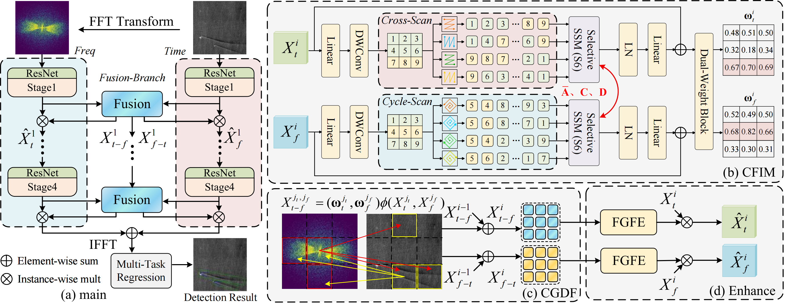

# 🚀 [Mamba-Based Time–Frequency Interactive Fusion Network for SAR Ship Wake Detection (IEEE TAES 2026)](https://ieeexplore.ieee.org/document/11664306/)

<p align="center">
  Lu Wang<sup>1,2</sup>, Bailiang Sun<sup>1,✉</sup>, Hongxing Wang<sup>3</sup>, Shaoguang Huang<sup>4</sup>, Tomoaki Ohtsuki<sup>5</sup>, P. Takis Mathiopoulos<sup>1,2,6</sup>
</p>


<p align="center">
  <!-- Replace the following line with the exact affiliations from the paper. -->
  <sup>1</sup>Harbin Engineering University, <sup>2</sup>Ministry of Industry and Information Technology, <sup>3</sup>Chongqing University, <sup>4</sup>China University of Geosciences, <sup>5</sup>Keio University, <sup>6</sup>National and Kapodistrian University of Athens
</p>


<p align="center">
  
  
  
</p>


## 🧠 Abstract

SAR ship wakes exhibit elongated structures and strong directionality, making their detection challenging under sea clutter and speckle noise. **TFIFNet** combines Mamba-based long-range modeling with time–frequency feature interaction to capture wake morphology and structural continuity.

TFIFNet enhances complementary time–frequency representations through three key components:

- **Cross-domain Feature Interaction Module (CFIM):** models complementary relationships between time-domain and frequency-domain wake features.
- **Complementarity-Guided Dense Fusion (CGDF):** integrates cross-domain features using global complementary information.
- **Fusion-Guided Feature Enhancement (FGFE):** strengthens the discriminative representations of both branches using fused features.

## 🏗️ Model Overview

<p align="center">
  
</p>


## ⚙️ Installation

Validated environment:

- Python 3.9
- CUDA 12.4
- PyTorch 2.0.1

```bash
# 1) Create environment
conda create -n tfifnet python=3.9 -y
conda activate tfifnet

# 2) Install PyTorch
pip install torch==2.0.1 torchvision==0.16.2 \
  --index-url https://download.pytorch.org/whl/cu118

# 3) Clone this repository
git clone https://github.com/luwang_Lucia/TFIFNet.git
cd TFIFNet

# 4) Build modules for calculating OBB overlap and performing Radon transform:
cd $ROOT/utils
sh make.sht
```

## 📚 Citation

If you find **TFIFNet** useful in your research or applications, please consider giving this repository a star ⭐ and citing our paper.

```bibtex
@article{wang2026tfifnet,
  title   = {Mamba-Based Time--Frequency Interactive Fusion Network for SAR Ship Wake Detection},
  author  = {Wang, L. and Sun, B. and Wang, H. and Huang, S. and Ohtsuki, T. and Mathiopoulos, P. T.},
  journal = {IEEE Transactions on Aerospace and Electronic Systems},
  year    = {2026},
  volume  = {62},
   pages  = {16327-16342},
  url     = {https://ieeexplore.ieee.org/document/11664306/}
}
```
